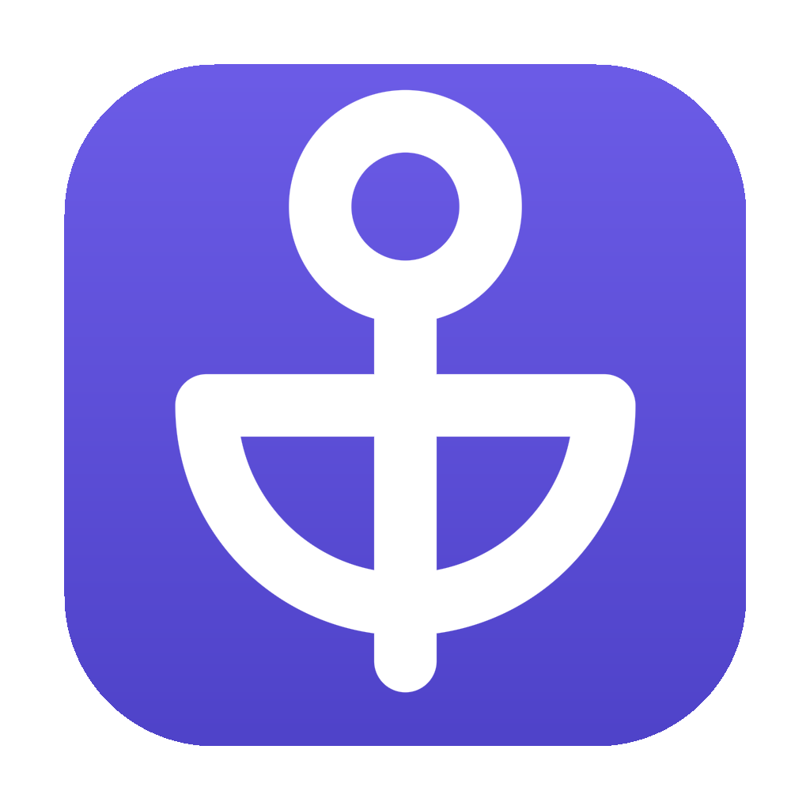

<p align="center">
  
</p>

<h1 align="center">Anchor</h1>

<p align="center">
  <b>Your Antigravity, anchored to you.</b><br>
  A desktop client for Google's Antigravity CLI: chat with your Google AI
  subscription, browse every conversation, build and train skills, share them,
  and pick up any session from any device through your own Google Drive.
</p>

<p align="center">
  <a href="https://github.com/Majidul17068/anchor/releases/latest"></a>
  
  
  <a href="LICENSE"></a>
</p>

---

**Anchor** wraps Google's Antigravity CLI (`agy`) in a native desktop app, the
way OpenClaw wraps a terminal agent. It never holds model credentials: the CLI
signs you in with Google, your AI Pro or Ultra entitlement applies
automatically, and Anchor talks to it over the Agent Client Protocol that
editors such as Zed use. Nothing is hosted: your sessions stay on your
machines and in your own Google Drive.

## What you get

- **Chat** with Gemini, Claude and other models your plan allows, with streaming
  answers, visible thinking, tool-call cards, inline permission prompts and
  edit diffs. Pick model, thinking level and mode (ask first, plan, auto,
  accept edits) per session.
- **History** of every conversation the CLI has ever had on this machine, with
  full-text search, filters, resume and Markdown export.
- **Agents**: create your own agent definitions (instructions, tools, model)
  as files the CLI discovers, alongside plugin and built-in agents.
- **Skills**: a SKILL.md editor with file tree, versions and rollback, a
  **Train** loop that runs example prompts through the agent and grades them,
  and **Improve**, which asks the agent to revise the skill from failures.
- **Share** a skill with another Google account through Drive, or import one
  from a share link.
- **Adapt from GitHub**: paste any public repository. Folders holding a
  `SKILL.md` are installed as skills; a Claude Code plugin (such as
  [academic-research-skills](https://github.com/imbad0202/academic-research-skills))
  is converted by `agy plugin install`, agents, commands and hooks included; a
  plain repository becomes one skill built from its README.
- **Marketplace**: a public catalog of community skills (a GitHub repository,
  no server): browse, install, publish, request.
- **Sync**: the device that created a session is its *parent source* and is
  the only one that can publish it. Other devices pull it automatically and
  can continue it; the parent merges their replies.

## Download

Grab the file for your OS from the **[latest release](https://github.com/Majidul17068/anchor/releases/latest)**.

| OS | File | First run |
|----|------|-----------|
| **macOS** (Apple silicon and Intel) | `anchor-macos-universal.dmg` | Drag to Applications and open. Releases built with the Apple signing secrets (see [Signing](#signing-and-notarization)) are notarized and open without warnings. An unsigned build shows *"Anchor" is damaged* or *cannot be opened*; fix it with `xattr -dr com.apple.quarantine /Applications/Anchor.app`, then right-click → Open. |
| **Windows** | `anchor-windows-amd64-setup.exe` | Run the installer. SmartScreen → *More info → Run anyway*. A portable `anchor-windows-amd64.exe` is attached too. |
| **Linux** | `anchor-linux-amd64.tar.gz` | `tar xzf anchor-linux-amd64.tar.gz && ./Anchor` (needs WebKitGTK 4.1, present on most desktops) |

Every release also ships `anchorctl`, a terminal companion for diagnostics and
scripting (`anchorctl doctor`, `anchorctl sessions`, `anchorctl chat new "…"`).

## First run

1. **Antigravity CLI**: Anchor looks for `agy`. If it is missing, one click runs
   Google's official installer for your platform.
2. **Sign in with Google**: the CLI opens your browser; use the account that
   holds your Google AI subscription. Anchor shows the tier it reports.
3. **Name this device**: it becomes the parent source for sessions you create here.
4. **Connect Google Drive** (optional): enables sync and skill sharing. See
   [docs/DRIVE_SETUP.md](docs/DRIVE_SETUP.md) if your build has no OAuth client id yet.

## How it is built

```
anchor/
├── main.go, api.go       Wails v2 app; API methods implement the UI's bridge contract
├── internal/
│   ├── acp/              JSON-RPC client for `agy acp` (Agent Client Protocol v1)
│   ├── engine/           sessions, streaming, permissions, history replay, search
│   ├── cli/              locate, version and install the Antigravity CLI
│   ├── skills/ agents/   SKILL.md and agent files the CLI discovers
│   ├── drive/ sync/      Google Drive OAuth and the parent-source sync engine
│   ├── market/           serverless marketplace client (GitHub-backed index)
│   └── store/            ~/.anchor metadata: sessions, device, settings
├── cmd/anchorctl/        terminal companion using the same engine
├── frontend/             React + TypeScript UI (window.anchorBridge contract)
├── build/                icons and platform manifests for Wails
└── .github/workflows/    ci.yml (vet, tests, typecheck) and build.yml (3-OS release)
```

The UI only ever calls `window.anchorBridge`. In a browser it falls back to a
complete mock, so the design can be iterated without the desktop shell.

## Develop

```bash
# prerequisites: Go 1.27+, Node 22+, Wails v2 CLI
go install github.com/wailsapp/wails/v2/cmd/wails@v2.17.1

wails dev                 # live-reload desktop app
cd frontend && npm run dev   # UI alone in the browser, with mock data

go test ./...             # backend tests
cd frontend && npm run typecheck && npm test

wails build               # build/bin/Anchor(.app|.exe)
scripts/build-mac.sh      # macOS: build, ad-hoc sign, install to ~/Applications
go build ./cmd/anchorctl  # terminal companion
```

Local data: `~/.anchor` (settings, device id, session metadata, transcript
cache, logs). The CLI's own data stays in `~/.gemini`.

## Signing and notarization

Gatekeeper refuses an app that is not signed with a Developer ID certificate
and notarized by Apple; that is why an unsigned build reports *"Anchor" is
damaged*. The release workflow signs and notarizes automatically when these
repository secrets exist (Settings → Secrets and variables → Actions):

| Secret | Value |
|--------|-------|
| `APPLE_CERTIFICATE_P12` | Your *Developer ID Application* certificate exported from Keychain Access as `.p12`, base64-encoded (`base64 -i cert.p12 \| pbcopy`) |
| `APPLE_CERTIFICATE_PASSWORD` | The password chosen at export |
| `APPLE_SIGNING_IDENTITY` | The certificate's common name, e.g. `Developer ID Application: Your Name (TEAMID)` |
| `APPLE_ID` | The Apple ID of the developer account |
| `APPLE_TEAM_ID` | The 10-character team id |
| `APPLE_APP_PASSWORD` | An [app-specific password](https://support.apple.com/102654) for that Apple ID |

A paid Apple Developer Program membership is required for the certificate.
Without the secrets the workflow still builds and ad-hoc signs, and the README
download table tells users how to open it. `scripts/build-mac.sh` honours the
same variables from the environment for local signed builds.

Windows builds are unsigned; SmartScreen shows *More info → Run anyway* until
an Authenticode certificate is added.

## Release

```bash
git tag v0.1.0 && git push origin v0.1.0   # CI builds macOS, Windows, Linux and attaches them to a Release
```

Optional repository secrets `ANCHOR_GOOGLE_CLIENT_ID` and
`ANCHOR_GOOGLE_CLIENT_SECRET` bake the Drive OAuth client into the binaries.

## Honest limits

- **Delete** removes a session from Anchor only; the CLI keeps its transcript
  until you delete it there.
- **Sharing** works with any Google account; Anchor cannot check whether the
  recipient has an AI subscription.
- **Thinking level** follows what the CLI exposes over ACP today: low, medium
  and high.
- **Marketplace** moderation is manual: publishing and requests open GitHub
  issues that maintainers fold into the index.

## License

[MIT](LICENSE) © Majidul Islam
